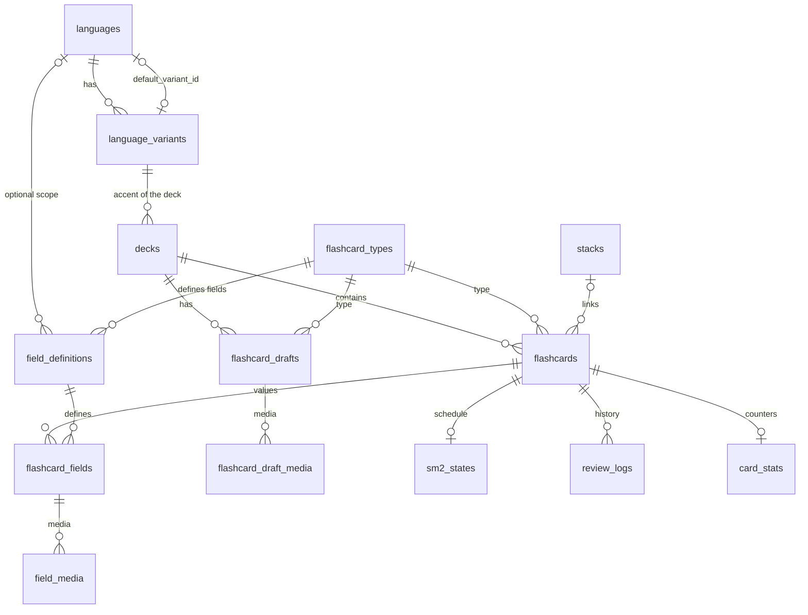

# Data model

One migration (v1.0) defines the schema and the seed data, in `src-tauri/src/dependencies/db/migrations.rs`.

## Conventions

- **Times are UTC**, stored as `TEXT` in the `YYYY-MM-DD HH:MM:SS` format of SQLite's `datetime('now')`. Columns filled by `DEFAULT (datetime('now'))` and columns written by Rust compare and sort the same way. The format is defined in one place, `src-tauri/src/dependencies/clock.rs`.
- **Booleans** are `INTEGER` 0 or 1, with a `CHECK`.
- **Enums** are `TEXT` with `CHECK (... IN (...))`, because SQLite has no `ENUM`. The length of `VARCHAR(n)` is not enforced either, so it is checked with `CHECK (length(...))` or in Rust.
- The app has **a single profile**, so there is no `users` table.
- Foreign keys are on for every connection (`PRAGMA foreign_keys = ON`).
- `flashcards` and `flashcard_drafts` have a `uuid`, the opaque identifier the view uses. See [architecture.md](architecture.md).

## Diagram

## Languages

- `languages`: `iso_639_1` (2 letters, optional), `iso_639_3` (3 letters, required and unique), `name` and `default_variant_id`.
- `language_variants`: `language_id`, `bcp47_code` (unique, up to 10 characters), `variant_name` and `country_code` (2 letters, optional, used for the flag). Deleting a language deletes its variants.
- The two tables reference each other, so `default_variant_id` is nullable and is set once the variant exists. The first variant created for a language becomes its default.
- **Seed:** the app starts with English (en-US, which is the default, and en-GB), French (fr-FR), Portuguese (pt-BR), Spanish (es-ES, which is the default, and es-MX) and German (de-DE). More languages and accents are added later as data.

## Decks

`decks`: a unique `name`, `language_variant_id` (`ON DELETE RESTRICT`, so a variant in use by a deck cannot be deleted), `description`, the study settings and `created_at`. The settings are `new_cards_per_day` (default 20, 0 to 9999), `max_reviews_per_day` (default 200, 0 to 9999) and `autoplay_audio` (default 1, whether the audio of a card plays by itself in a review). Both limits are counted per **UTC day**.

## Flashcards

A card's layout is **data, not code**:

- `flashcard_types` (unique `slug`, `name`, `description`). **Seed:** `vocabulary`, `phonetic` and `orthographic`.
- `field_definitions`: one row per field a type can have. Columns: `flashcard_type_id`, `language_id`, `side` (`FRONT` or `BACK`), `key`, `label`, `position`, `is_required`, `media_allowed`, `kind` and `source_key`. `kind` is `PLAIN` (text), `RICH` (HTML, edited in the rich editor), `AUDIO` (only audio, uploaded or generated) or `IPA` (HTML with the pronunciation of the words of another field, generated from the pronunciation dictionary). `source_key` is set exactly for `AUDIO` and `IPA` fields: the key of the field they are generated from, and an audio field must allow media (both are `CHECK`s). Unique per type, language and key.
- `flashcards`: `uuid`, `deck_id` (`ON DELETE CASCADE`), `flashcard_type_id`, `stack_id`, `created_at` and `updated_at`.
- `flashcard_fields`: one value per field with content (`field_definition_id`, `content`). Unique per card and definition. A field whose only content is media has an empty `content`.
- `field_media`: media attached to a saved field (see below).

**Seeded fields:**

| Type | Side | Key | Required | Rich | Media |
|---|---|---|---|---|---|
| vocabulary | FRONT | `phrase` | yes | yes | yes |
| vocabulary | BACK | `word_or_expression` | yes | no | no |
| vocabulary | BACK | `meaning` | yes | yes | no |
| phonetic | FRONT | `phrase` | yes | no | no |
| phonetic | BACK | `ipa_phonetics` (kind `IPA`, made from `phrase`) | yes | yes | no |
| orthographic | FRONT | `audio` (kind `AUDIO`, spoken from `phrase`) | yes | no | yes |
| orthographic | FRONT | `phrase` (position 1, after the audio) | yes | no | no |

Orthographic has no back: both of its fields are on the front.

### How the fields of a deck are resolved

A definition with `language_id` NULL applies to every language. With a `language_id`, it applies only to decks of that language, and it **replaces** the language-agnostic definition with the same key. For example, definitions limited to Japanese can add `hiragana` and `romaji` to the back of vocabulary cards. A new language or a new type is just an `INSERT`, with no schema change. `CardTypeApi::fields_for(type_slug, language_id)` does the resolution.

### What SQLite does not guarantee

That the `field_definition_id` of a `flashcard_fields` row belongs to the card's type and language. The editor orchestrator checks it.

## Drafts

`flashcard_drafts` are unsaved flashcards being edited, so the work survives restarts: `uuid`, `deck_id` (`ON DELETE CASCADE`), `flashcard_type_id`, `position`, `values_json` and `updated_at`. A deck has **one list of drafts that mixes flashcard types**: `position` is the order in that list, across types. `values_json` maps a field key to the typed text. It is opaque to SQL and never queried by field.

Publishing turns all of a deck's drafts into flashcards, each with the type of its draft, and deletes the drafts, all or nothing.

## Media

Images, audio and video live in S3 and are read offline from a local folder (`media/` inside the app data folder). The files are named `<sha256>.<ext>`, so identical content is stored once.

- `flashcard_draft_media`: files attached to a draft by field key (`kind` `IMAGE`, `AUDIO` or `VIDEO`, `mime_type`, `sha256`, `file_name`, `size_bytes`, `position`). Unique per draft, field and hash.
- `field_media`: the same for a saved field (`flashcard_field_id`), plus `remote_key`, the S3 object key, NULL until the file is uploaded.

Audio can also be generated from a field's text with text to speech. The result is stored exactly like an uploaded file (the media folder and the same rows), so reviewing never needs the network. Publishing copies the draft rows into `field_media`. A future sync compares the rows with the files on disk, downloads the missing ones and uploads the rows without a `remote_key`.

## Stacks

`stacks` (`id`, `uuid`, `created_at`) links the flashcards that were made together: the vocabulary, phonetic and orthographic cards of one phrase. The cards stay independent (each has its own type, fields and review history), and the link only lets them be shown and edited together. `uuid` is the opaque identifier the view uses. `flashcards.stack_id` is nullable (`ON DELETE SET NULL`), so deleting a stack row keeps its cards. A stack with fewer than two cards is dissolved: the remaining card is unlinked and the row deleted. Stack is not a flashcard type.

Before they are published, the drafts of a stack share `flashcard_drafts.stack_uuid`; publishing creates the `stacks` row with that uuid in the same transaction and links the cards.

## Pronunciation dictionary

The IPA text of a phonetic card comes from `ipa.db`, a separate SQLite file in the app data folder, which is not part of the repository. `entries(language, word, ipa)` has one first pronunciation per word and language (the language is the deck variant's BCP 47 code), and `languages(language, words)` says what is installed. It is built by an import from the `ipa-dict` word lists and only read afterwards.

## Review

See [review.md](review.md). All three tables hang off `flashcards` with `ON DELETE CASCADE`:

- `sm2_states`: one SM-2 state per card (`due_at`, `interval_days`, `ease_factor`, `repetitions`, `last_reviewed_at`, `learning_step`). A card with no row has never been reviewed.
- `review_logs`: one append-only row per review (`reviewed_at`, `rating` 1 to 4, `elapsed_days`, `scheduled_days`, `duration_ms`, `phase`). `phase` is what the card was when answered: `NEW` (its first review ever), `LEARNING` (not recalled yet: the first wave, or relearning after Again) or `REVIEW` (recalled before). The deck's daily limits are measured with it. `previous` holds the card's `sm2_states` and `card_stats` rows as they were before the review, as JSON (a missing row is `null`), so that undoing the review can put them back.
- `card_stats`: per-card counters (`review_count`, `correct_count`, `lapses`, `total_duration_ms`, `last_rating`), independent of the algorithm.
