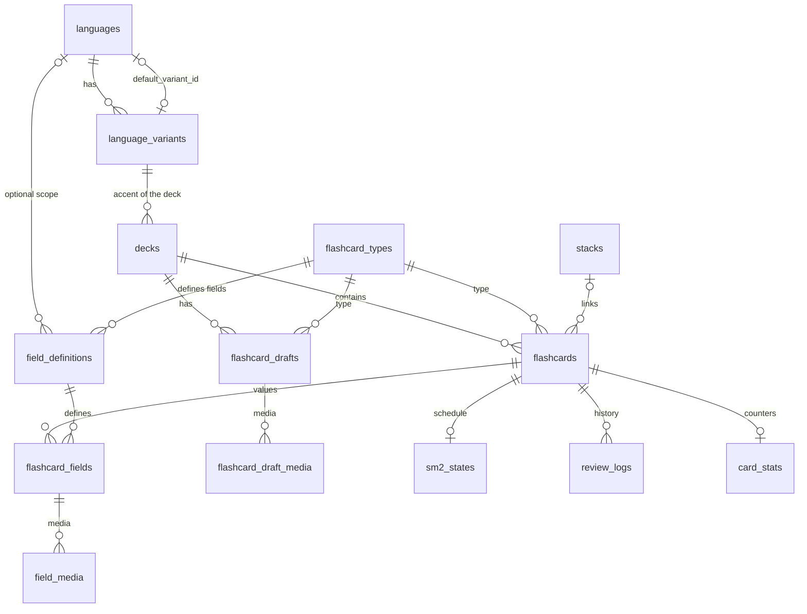

# Data model

One migration (v1.0) defines the schema and the seed data, in `src-tauri/src/dependencies/db/migrations.rs`.

## Conventions

- **Times are UTC**, stored as `TEXT` in the `YYYY-MM-DD HH:MM:SS` format of SQLite's `datetime('now')`. Columns filled by `DEFAULT (datetime('now'))` and columns written by Rust compare and sort the same way. The format is defined in one place, `src-tauri/src/dependencies/clock.rs`.
- **Booleans** are `INTEGER` 0 or 1, with a `CHECK`.
- **Enums** are `TEXT` with `CHECK (... IN (...))`, because SQLite has no `ENUM`. The length of `VARCHAR(n)` is not enforced either, so it is checked with `CHECK (length(...))` or in Rust.
- The app has **a single profile**, so there is no `users` table.
- Foreign keys are on for every connection (`PRAGMA foreign_keys = ON`).
- `flashcards` and `flashcard_drafts` have a `uuid`, the opaque identifier the view uses. See [architecture.md](architecture.md).

## Diagram

## Languages

- `languages`: `iso_639_1` (2 letters, optional), `iso_639_3` (3 letters, required and unique), `name` and `default_variant_id`.
- `language_variants`: `language_id`, `bcp47_code` (unique, up to 10 characters), `variant_name` and `country_code` (2 letters, optional, used for the flag). Deleting a language deletes its variants.
- The two tables reference each other, so `default_variant_id` is nullable and is set once the variant exists. The first variant created for a language becomes its default.
- **Seed:** English (en-US, en-GB), Portuguese (pt-BR, pt-PT), Spanish (es-ES, es-MX), French (fr-FR, fr-CA), Italian, German, Japanese, Chinese (zh-CN, zh-TW) and Korean. The first variant listed is the default.

## Decks

`decks`: a unique `name`, `language_variant_id` (`ON DELETE RESTRICT`, so a variant in use by a deck cannot be deleted), `description` and `created_at`.

## Flashcards

A card's layout is **data, not code**:

- `flashcard_types` (unique `slug`, `name`, `description`). **Seed:** `vocabulary`, `phonetic` and `orthographic`.
- `field_definitions`: one row per field a type can have. Columns: `flashcard_type_id`, `language_id`, `side` (`FRONT` or `BACK`), `key`, `label`, `position`, `is_required`, `media_allowed` and `is_rich` (the content is HTML, edited in the rich editor, as opposed to plain text). Unique per type, language and key.
- `flashcards`: `uuid`, `deck_id` (`ON DELETE CASCADE`), `flashcard_type_id`, `stack_id`, `created_at` and `updated_at`.
- `flashcard_fields`: one value per field with content (`field_definition_id`, `content`). Unique per card and definition. A field whose only content is media has an empty `content`.
- `field_media`: media attached to a saved field (see below).

**Seeded fields:**

| Type | Side | Key | Required | Rich | Media |
|---|---|---|---|---|---|
| vocabulary | FRONT | `phrase` | yes | yes | yes |
| vocabulary | BACK | `word_or_expression` | yes | no | no |
| vocabulary | BACK | `meaning` | yes | no | no |
| phonetic | FRONT | `phrase` | yes | no | no |
| phonetic | BACK | `ipa_phonetics` | yes | yes | no |
| orthographic | FRONT | `phrase` | yes | no | yes |

### How the fields of a deck are resolved

A definition with `language_id` NULL applies to every language. With a `language_id`, it applies only to decks of that language, and it **replaces** the language-agnostic definition with the same key. For example, definitions limited to Japanese can add `hiragana` and `romaji` to the back of vocabulary cards. A new language or a new type is just an `INSERT`, with no schema change. `CardTypeApi::fields_for(type_slug, language_id)` does the resolution.

### What SQLite does not guarantee

That the `field_definition_id` of a `flashcard_fields` row belongs to the card's type and language. The editor orchestrator checks it.

## Drafts

`flashcard_drafts` are unsaved flashcards being edited, so the work survives restarts: `uuid`, `deck_id` (`ON DELETE CASCADE`), `flashcard_type_id`, `position` (the order in the editor), `values_json` and `updated_at`. `values_json` maps a field key to the typed text. It is opaque to SQL and never queried by field.

Publishing turns a deck's drafts of a type into flashcards and deletes them, all or nothing.

## Media

Images and audio live in S3 and are read offline from a local folder (`media/` inside the app data folder). The files are named `<sha256>.<ext>`, so identical content is stored once.

- `flashcard_draft_media`: files attached to a draft by field key (`kind` `IMAGE` or `AUDIO`, `mime_type`, `sha256`, `file_name`, `size_bytes`, `position`). Unique per draft, field and hash.
- `field_media`: the same for a saved field (`flashcard_field_id`), plus `remote_key`, the S3 object key, NULL until the file is uploaded.

Publishing copies the draft rows into `field_media`. A future sync compares the rows with the files on disk, downloads the missing ones and uploads the rows without a `remote_key`.

## Stacks

`stacks` (`id`, `created_at`) only links independent flashcards, for future features that relate them. `flashcards.stack_id` is nullable (`ON DELETE SET NULL`), so deleting a stack keeps its cards. Stack is not a flashcard type.

## Review

See [review.md](review.md). All three tables hang off `flashcards` with `ON DELETE CASCADE`:

- `sm2_states`: one SM-2 state per card (`due_at`, `interval_days`, `ease_factor`, `repetitions`, `last_reviewed_at`). A card with no row has never been reviewed.
- `review_logs`: one append-only row per review (`reviewed_at`, `rating` 1 to 4, `elapsed_days`, `scheduled_days`, `duration_ms`).
- `card_stats`: per-card counters (`review_count`, `correct_count`, `lapses`, `total_duration_ms`, `last_rating`), independent of the algorithm.
