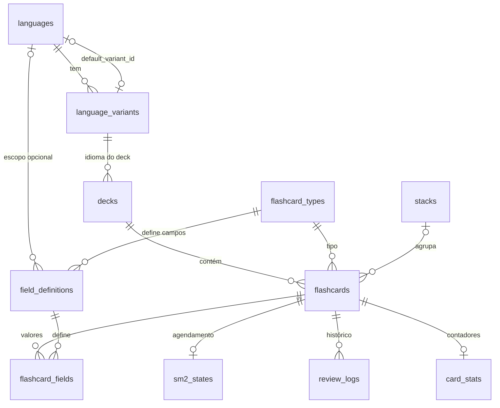

# Modelo de dados

Um único migration (v1.0) define o schema, em `src-tauri/src/dependencies/db/migrations.rs`.

## Convenções

- **Horários em UTC**, como `TEXT` no formato `YYYY-MM-DD HH:MM:SS`, o mesmo de `datetime('now')` do SQLite. Colunas preenchidas por `DEFAULT (datetime('now'))` e colunas escritas pelo Rust são comparáveis e ordenáveis do mesmo jeito. O formato é definido em um só lugar, `src-tauri/src/dependencies/clock.rs`.
- **Booleanos** são `INTEGER` 0 ou 1, com `CHECK`.
- **Enums** são `TEXT` com `CHECK (... IN (...))`, porque o SQLite não tem `ENUM`. O tamanho de `VARCHAR(n)` também não é imposto, então é validado por `CHECK (length(...))` ou pelo Rust.
- O app tem **um único perfil**, por isso não existe tabela `users`.
- As foreign keys são ligadas em toda conexão (`PRAGMA foreign_keys = ON`).

## Diagrama



## Idiomas

- `languages`: `iso_639_1` (2 letras, opcional), `iso_639_3` (3 letras, obrigatório e único), `name` e `default_variant_id`.
- `language_variants`: `language_id`, `bcp47_code` (único, até 10 caracteres), `variant_name` e `country_code` (2 letras, opcional). Apagar um idioma apaga os variants dele.
- As duas tabelas se referenciam. Por isso `default_variant_id` é nullable e é preenchido depois que o variant existe. O primeiro variant criado para um idioma vira o default.

## Decks

`decks`: `name`, `language_variant_id` (`ON DELETE RESTRICT`, não dá para apagar um variant que um deck usa), `description` e `created_at`.

## Flashcards

O layout de um card é **dado, não código**:

- `flashcard_types` (`slug` único, `name`, `description`): vocabulary, orthographic e phonetic. Os registros iniciais ainda não são criados pela migration.
- `field_definitions`: uma linha por campo que um tipo pode ter. Colunas: `flashcard_type_id`, `language_id`, `side` (`FRONT` ou `BACK`), `key`, `label`, `position`, `is_required` e `media_allowed`. Único por tipo, idioma e `key`.
- `flashcards`: `deck_id` (`ON DELETE CASCADE`), `flashcard_type_id`, `stack_id`, `created_at` e `updated_at`.
- `flashcard_fields`: um valor por campo preenchido (`field_definition_id`, `content`). Único por card e definição.

### Como os campos de um deck são resolvidos

Uma definição com `language_id` NULL vale para todos os idiomas. Com `language_id` preenchido, vale só para decks daquele idioma. Os campos de um card são então:

```sql
SELECT fd.id, fd.side, fd.key, fd.label, fd.is_required
FROM field_definitions fd
JOIN decks d ON d.id = ?1
JOIN language_variants lv ON lv.id = d.language_variant_id
WHERE fd.flashcard_type_id = ?2
  AND (fd.language_id IS NULL OR fd.language_id = lv.language_id)
ORDER BY fd.side DESC, fd.position;   -- FRONT antes de BACK
```

Exemplo: o tipo `vocabulary` tem `phrase` (FRONT), `word_or_expression` e `meaning` (BACK) para todos os idiomas. Para japonês, definições extras com `language_id` de japonês acrescentam `hiragana` e `romaji` ao BACK. Um idioma novo ou um tipo novo é só um `INSERT`, sem mudar o schema.

Esse SQL cruza tabelas de módulos diferentes, então no código ele vira uma orquestração (veja [arquitetura.md](arquitetura.md)).

### O que o SQLite não garante

Que um `field_definition_id` de `flashcard_fields` pertença ao tipo e ao idioma do card. Essa checagem é do service de flashcards.

## Stacks

`stacks` (`id`, `created_at`) é só um vínculo entre flashcards independentes, para funcionalidades futuras que os relacionem. `flashcards.stack_id` é nullable (`ON DELETE SET NULL`), então apagar uma stack mantém os cards.

## Revisão

Veja [revisao.md](revisao.md) para as regras. As tabelas, todas com `ON DELETE CASCADE` a partir de `flashcards`:

- `sm2_states`: um estado SM-2 por card (`due_at`, `interval_days`, `ease_factor`, `repetitions`, `last_reviewed_at`). Um card sem linha nunca foi revisado.
- `review_logs`: histórico de cada revisão, só de inserção (`reviewed_at`, `rating` de 1 a 4, `elapsed_days`, `scheduled_days`, `duration_ms`).
- `card_stats`: contadores por card (`review_count`, `correct_count`, `lapses`, `total_duration_ms`, `last_rating`), independentes do algoritmo.

## Ainda não existe

- `field_media`, para mídia dos campos.
- Os registros iniciais de `flashcard_types` e `field_definitions`.
